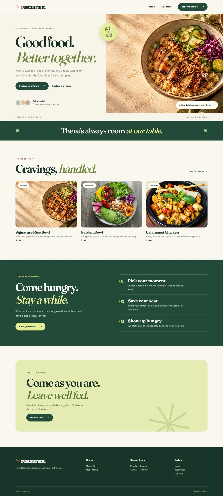

# Restaurant Reservations

A WordPress restaurant website with an editable menu and a table reservation workflow. Guests can browse dishes, choose a date and time, and receive a booking reference. Staff manage reservations and menu items in WordPress Admin.



## Features

- Responsive home, menu, about, and reservation pages
- Menu items with categories, prices, badges, and images
- Reservation validation for date, time, party size, and contact details
- Booking references, guest and administrator email notifications, and an admin booking list
- Local Docker environment with MariaDB, WordPress, Mailpit, and WP-CLI

## Local setup

Requires Docker Desktop with Compose and PowerShell 7. The default ports are `127.0.0.1:18087` for WordPress and `127.0.0.1:18088` for the local email inbox. Confirm those ports are free, then run:

```powershell
Get-NetTCPConnection -LocalPort 18087,18088 -State Listen -ErrorAction SilentlyContinue
$env:WP_ADMIN_PASSWORD = 'choose-a-long-unique-password'
.\setup.ps1
Remove-Item Env:WP_ADMIN_PASSWORD
```

On first run, the script creates a private `.env` with random database passwords, installs WordPress, activates the theme, configures Post name permalinks and the Manila timezone, and creates the site pages and initial menu items. Rerunning it preserves existing content, reservations, and administrator credentials.

Open [the local website](http://127.0.0.1:18087/) and sign in at `/wp-admin/` as `site_admin` with the password you supplied. An existing installation keeps its original administrator account. To use different ports, run `.\setup.ps1 -SitePort 18089 -MailpitPort 18090` with free port numbers.

The database and WordPress files persist in Docker volumes. `docker compose down` stops only this project and retains those volumes. `docker compose down -v` deletes them and all stored site data. Changing a password in `.env` does not rotate an existing database user's password.

## Site operations

| Task | WordPress location |
| --- | --- |
| Edit menu items, prices, categories, and images | **Menu dishes** |
| View reservations and guest details | **Reservations** |
| Release a booked slot | Move its reservation to Trash |

Reservations accept parties of 1–8, dates up to 60 days ahead, and bookings made at least two hours before the selected time. A database lock prevents simultaneous website requests from exceeding the current ten-party limit per 90-minute slot. Set that limit to match the restaurant's actual tables before launch. Email sent by the local Docker environment is captured in [Mailpit](http://127.0.0.1:18088/).

## Verification

With Docker running, use Node.js and Python to run the included checks:

```powershell
node qa/reservation-smoke.mjs
node qa/capacity-smoke.mjs
python qa/chrome-mcp-check.py
```

The first check validates booking errors, confirmation, email capture, and cleanup. The capacity check submits twelve bookings simultaneously, verifies that at most ten succeed, and removes its test bookings. The Chrome DevTools MCP check covers navigation, the menu filter, mobile layout, and a browser booking. The local setup and deployment requirements are documented in the [setup guide](docs/setup-guide.pdf).

## Deployment requirements

The site is a standard WordPress theme. For an existing WordPress installation, copy `theme/` to `wp-content/themes/salo/` or package it as a theme ZIP, then activate **Restaurant Reservations** in WordPress Admin. Activation creates the site pages and initial dishes. Set the homepage to **Home**, Post name permalinks, and the **Asia/Manila** timezone. Do not deploy the local `compose.yaml` unchanged: it includes Mailpit and binds WordPress to localhost.

Before accepting real reservations on a VPS, configure a domain and HTTPS, install and configure a WordPress SMTP delivery plugin, and confirm that both guest and administrator emails reach real inboxes. The theme uses WordPress `wp_mail()`, so an SMTP plugin can provide the production transport; do not set `RESTAURANT_DEMO_MAILPIT_HOST` on the VPS. Set the ten-party limit to the real floor plan, protect the form from abuse, arrange off-server backups and a restore test, and replace initial business content with a privacy notice and working cancellation/contact details. A live VPS and real SMTP check still requires the server, domain, and mail-provider configuration.

The theme is in [`theme/`](theme/). Its generated hero image is stored locally; initial menu images and fonts use external services.
